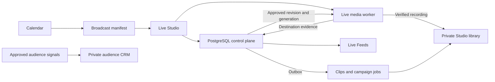

# Ziipa Live Media OS design

November 23, 2026 · Implementation proposal

Give each live broadcast one owner-scoped record that follows it from Calendar to Live Studio and Live Feeds, then into private recordings, clips, and promotion. Start with an approved landscape broadcast and a private recording that a creator can reopen in Studio. Add portrait production and the audience CRM as independent capabilities on that same record.

| Surface | Creator or viewer sees | Source of truth |
| --- | --- | --- |
| Calendar and Events | Schedule, title, upcoming event, Changes needed | Current broadcast manifest revision and existing Calendar occurrence. A calendar time never starts a camera or opens public ingest. |
| Live Studio | Prepare, review destinations, Go live, per-destination status, End | Approved manifest revision, current run generation, and provider evidence. Status tells the creator what each destination actually confirmed. |
| Live Feeds and Discover | Live Now, Upcoming, and creator-published Replays | Fresh verified Ziipa playback plus current visibility and moderation checks. Upcoming uses approved public event metadata. Replays are ordinary published creations. |
| Recordings and Clips | Processing, ready to edit, or action needed | Owned recording/master artifact and private Studio drafts. Imported media is never made public by this flow. |
| Promote and Audience | Review clips, view delivery receipts, see supporters who opted in | Existing publishing/campaign services, and a separate owner-only audience projection. |



The two source notes provide the feature backlog. I would adopt the manifest, preflight, destination status, private highlight queue and audience events. I would phase live ML tracking, semantic cues, and cross-platform promotion after measured acceptance. I would defer paid infrastructure, autonomous external posting, always-on channels, and ad insertion. A common event format can support alerts from approved providers without implying that Ziipa controls their chat, polls, payouts, or algorithms.

## Start from the existing stack

- `backend/live_api.py` already creates owner-scoped Livepeer streams, asks for explicit public start, checks current profile privacy and provider playback, and supports a Twitch destination. The public feed relies on fresh evidence. `mobile/src/components/broadcast-catalogue.tsx` and `mobile/src/lib/broadcast-events.ts` already group Live now, saved stream events, Recordings and Clips.
- `backend/live_webhooks.py` already verifies Livepeer signatures and confirms the asset-to-stream binding. `backend/live_recordings_worker.py` imports opted-in recordings and creates private clips through existing render jobs. Keep the existing 100 MiB / 30 minute importer bound until an alternative has its own capacity and privacy acceptance. Keep existing `creator_media` and Studio drafts as the creator-facing library records.
- The app's ingest, playback allowlists, recording and webhook receiver are Livepeer-specific today. Before a supported hosted beta, implement and test a separate provider adapter. Livepeer announced the Studio wind-down. FrameWorks documents its replacement API and a bounded free tier. Confirm Ziipa's actual plan and usage before an external test. [Livepeer transition](https://livepeer.org/blog/frameworks-livepeer-studio-transition) · [FrameWorks migration](https://logbook.frameworks.network/migrate/livepeer-studio/) · [FrameWorks limits](https://frameworks.network/pricing)

Use PostgreSQL, the existing Calendar/workflow worker patterns, and existing object storage for the first cut. Redis can wake workers, and each worker also polls PostgreSQL to handle a lost wakeup. Add a broker or a durable workflow service only when workload or service isolation calls for it. Keep video frames, audio samples, chat firehose data and high-rate transport metrics off the transactional outbox.

## PostgreSQL schema and outbox

The [PostgreSQL 17 reference schema](sql/ziipa-live-control-plane.sql) is executable against a disposable database with Ziipa's `public.users(id integer)` table. It lives outside the runtime migration chain. Its constraints enforce tenant-qualified relationships, the current manifest reference, destinations pinned to a run's revision, unique command IDs, one master per run, and one state change event per version. A later Alembic revision, service reducer and role grants are required for integration.

| Tables | Responsibility |
| --- | --- |
| `broadcasts`, `manifest_revisions`, `destination_revisions` | Stable broadcast ID, compare-and-swap `state_version`, current desired revision, immutable draft/scheduled configuration and validated destination profiles. |
| `broadcast_runs`, `destination_status`, `provider_operations` | One nonclosed generation per broadcast, start authority and expiry, evidence for each destination, and durable provider operation intents and receipts. |
| `commands`, `provider_inbox` | Dedupe creator and worker commands. Keep verified provider deliveries separate from domain facts until attribution and relevance are established. |
| `media_artifacts` | Private object keys, source lineage, committed sizes and digests. A registered artifact can be imported into the existing Ziipa library. |
| `events`, `event_deliveries`, `consumer_receipts` | Immutable domain events, independently retryable delivery per consumer, and transactional dedupe at consumers. |

The manifest revision includes the calendar occurrence, allowed ingest profiles, landscape/portrait choices, captions and safe overlay references, authorized audio route, recording/clip opt-ins, and destination options. Validate metadata against each adapter's supported fields and preview it before arming. Preserve the exact approved mapping by hashing canonicalized manifest and destination data together. Media takes a private config by immutable reference. Refresh OAuth grants at execution, store tokens and stream keys in the existing credential path or a short-lived scoped capability, and keep them out of manifests, URLs in logs, events, and UI receipts. Edits that change the approved destinations or policy require a new revision and approval. Lock edits to a running revision during the beta.

For example, a request to schedule a studio interview can save one required Ziipa landscape output, an optional approved portrait output, and a speech-only private recording. Calendar displays the scheduled time. Live Studio resolves the two profiles and previews both outputs. The creator may remove the portrait output before arming a new revision. The confirmed Ziipa output can appear in Live Feeds if portrait is still connecting. After Stop, the speech-only recording follows the approved recording policy into Studio, where the creator can edit and publish a replay.

### Transition contract

| Current state | Trigger and guard | Next state |
| --- | --- | --- |
| `draft` | Save a valid manifest and Calendar occurrence | `scheduled` |
| `draft` or `scheduled` | Manual prepare or a due preflight job for the current revision. Check credentials, quotas, recording capacity and profile compatibility privately. | `preflight` |
| `preflight` | Creator confirms public start for the displayed revision. Recheck owner standing, privacy and destination grants and open a bounded generation. | `awaiting_media` |
| `awaiting_media` | Ingest becomes stable. Start only the authorized outputs for that run. | `awaiting_media` |
| `awaiting_media` or `failover_hold` | At least one approved public destination and every required output are playable using fresh provider-specific evidence. Ziipa's public card separately requires fresh Ziipa playback. | `live` |
| `live` | Media is lost while publication authority is still current and the approved fallback can hold the output. | `failover_hold` |
| Active run | End, authority revoked, or start/failover deadline expires. Unlist immediately, close the run to new starts, then stop and reconcile provider outputs. | `winding_down` |
| `winding_down` | Output closure reconciled and authorized master verified, or recording resolves as skipped, unavailable or failed. | `post_processing` or `archived` |
| `post_processing` | Bounded private jobs settle. Available drafts and failures remain visible. Pending creator approval to publish is separate. | `archived` |

Pre-start cancel closes the occurrence without exposing ingest. Unrecoverable pre-start errors may mark it `failed`. After public start, incomplete cleanup remains `winding_down` with a visible provider receipt, even if the processor crashes. Optional destination failure is shown per destination and can degrade the session without stopping a healthy required output. Missing evidence, socket connection, or an old callback cannot mark any destination live. During failover, show a standby label only while its playback is verified. Run authorization expires on its own. Privacy changes, suspension, revocation and creator stop outrank automatic recovery.

### One commit for state, idempotency and event creation

Add authenticated owner commands behind existing `/api/live` routes. Accept `If-Match` for the `state_version` and a separate UUID `command_id` for retries. Use the following service transaction. The API resolves the owner from auth. Media workers use a service identity tied to the current run generation and permitted operations.

1. Lock the owner first for permission-changing operations, then the broadcast `(owner_id, id)` with `SELECT … FOR UPDATE`. Use the same owner-first order as the current live privacy path. Check `commands` before the stale-version check so a retry can retrieve the original receipt. Reject reuse for a different canonical request hash. Reject a new stale request with the current version, and require explicit review to retry an authority-changing command.
2. Run the state reducer under the lock using current privacy, grants, generation, revision and admitted evidence. Write the next state/version, relevant run or destination rows, and a safe command response. On Stop, mark the run `closing` in the same transaction and invalidate ingest leases. Do not perform a provider call inside this transaction.
3. Append an event and all intended delivery rows, then commit. Mark commands that set desired state as accepted, and expose async status until verified. For initial creation, insert the broadcast, manifest and initial event in a single transaction using the deferred manifest FK. Use the existing owner request-ID pattern for idempotent creation.

This is the producer query inside step 3, after the locked update and command receipt. The named placeholders are psycopg parameters resolved by the service. `consumers` is a server-owned list picked from event type and approved workflow policy.

```sql
WITH emitted AS (
  INSERT INTO ziipa_live.events
    (source, owner_id, broadcast_id, state_version, generation,
     event_type, subject, occurred_at, data)
  SELECT 'urn:ziipa:live:control', b.owner_id, b.id, b.state_version,
         nullif(b.generation, 0), 'com.ziipa.broadcast.state.changed.v1',
         'broadcasts/' || b.id::text, now(),
         jsonb_build_object('from', %(prior_state)s::text, 'to', b.state,
                            'manifest_revision', b.manifest_revision)
  FROM ziipa_live.broadcasts b
  WHERE b.owner_id = %(owner_id)s AND b.id = %(broadcast_id)s
  RETURNING owner_id, source, id
)
INSERT INTO ziipa_live.event_deliveries (owner_id, event_source, event_id, consumer)
SELECT e.owner_id, e.source, e.id, c.consumer
FROM emitted e CROSS JOIN unnest(%(consumers)s::text[]) AS c(consumer);
```

**Dispatcher.** `claim_deliveries` leases due rows with `FOR UPDATE SKIP LOCKED`, increments attempts, and supplies a fresh fencing token. Commit before starting work. Keep each operation below its 30-second lease or checkpoint it into its own durable job with a renewable lease. Ack or reschedule with `finish_delivery` and its current token. Use capped exponential backoff with jitter and provider retry guidance. Sweep expired pending rows at attempt 12 into `dead` with a finish timestamp and safe error code. Alert on oldest pending age, lost leases, retry count, dead rows and unmatched provider events. For safe replay, inspect the underlying operation, retain the original event ID, and audit who requeued it. There is no global event arrival order. Projections track versions per broadcast, fetch the current state on gaps, and process independent facts separately. [PostgreSQL 17 locking clauses](https://www.postgresql.org/docs/17/sql-select.html#SQL-FOR-UPDATE-SHARE)

**Consumers and providers.** A DB-only consumer inserts `(consumer, source, id)` in `consumer_receipts` and updates its projection and acknowledges in one short transaction. Roll back if ack rejects the lease. For provider I/O, create a stable `operation_id` for the logical action and persist `provider_operations` before calling the provider. The relay rechecks generation, phase, expiry and current grants at dispatch. Repeat the same provider idempotency key when supported. A crash or timeout after send without proof leaves an unresolved operation. Query the provider before retrying a non-idempotent action. On a Stop/start race, fence locally and reconcile or stop any late remote success. No database lease can cancel a provider request already in flight.

**Inbound.** Authenticate the provider, validate raw signed bytes and timestamp or challenge where supported, cap payloads and admit only supported events. Insert a minimal normalized receipt keyed by `(provider, subscription_ref, delivery_id)` before returning success. Replay with the same binding is a no-op. Quarantine conflicting identifiers and do not enqueue another action. Each adapter chooses stable signed dedupe fields. For Livepeer recording callbacks that still need an asset read, persist the minimum unbound receipt, then verify authoritative stream/session/asset binding asynchronously before producing an owned artifact event. The worker selects due candidates, fetches provider evidence outside the lock, and rechecks the pending row and current authority under lock. Inbox status, domain changes and emitted events commit together. Duplicate readers may repeat a fetch but only one applies the outcome. Expire unbound rows, bound retention to each provider's replay obligations and retain durable artifact/action keys beyond inbox pruning. Redis can limit traffic but never serves as the durable dedupe record.

**Envelope and access.** Serialize `specversion: "1.0"`, UUID `id` as a string, URI `source`, versioned `type`, `subject`, UTC `time`, `datacontenttype: "application/json"`, and `data`. Dedupe uses `(source, id)`. Pass `broadcast_id`, `manifest_revision`, `state_version`, `generation` and `destination_id` in `data` when applicable. Use types like `com.ziipa.broadcast.ingest.stable.v1`, `com.ziipa.broadcast.destination.playback_verified.v1`, `com.ziipa.broadcast.ingest.lost.v1` and `com.ziipa.broadcast.master.committed.v1`. Remove raw provider payloads, personal identifiers and object URLs from shared control events. Any later outbound creator webhook needs per-subscription credentials, opt-in and event allowlists. Sign timestamp plus exact body bytes with HMAC-SHA256, check the clock window and dedupe, and use an isolated egress worker with approved HTTPS targets and private-network/redirect protections. The schema is private; grant only restricted service roles and tenant-qualified reads. Application roles can append events, while a restricted retention job handles erasure. No direct browser DB access. [CloudEvents specification](https://github.com/cloudevents/spec/blob/v1.0.2/cloudevents/spec.md)

## Live media and audience layers

The [GStreamer/FFmpeg pipeline](ZIIPA-LIVE-MEDIA-PIPELINE.md) describes supported ingest formats, shared timing, destination-isolated output branches, audio routing, failover, and private recording lineage. Begin with 16:9 playback, deliberate manual framing for an optional 9:16 output, and separate mic/music tracks from a capable encoder. Automatic separation is an optional experiment. A derived track can still contain music and carries the source's rights restrictions.

The [Audience CRM design](ZIIPA-LIVE-AUDIENCE-CRM.md) defines per-creator audience identities, verified opt-in links, provider data permissions and revocation. An event can contribute to an approved per-source view without identifying a human across platforms. Anonymous viewing remains aggregate. Engagement and paid-event signals power eligible alerts. Settlement evidence and financial records live separately from the audience graph.

On `master.committed`, enqueue a durable job to register the private source, then score candidate ranges from eligible timestamped signals, render limited portrait drafts with captions, and group them in Studio by broadcast. Version the analysis and render parameters. Dedupe side effects by master artifact/checksum, step, parameters and revision. Reuse bounded render and workflow jobs. A step may fail without losing the master. Publish uses the current Studio/campaign controls with review of the exact asset and destination. Start with explicit chapter/clip marks so the flow also works without ASR, chat or model capacity.

## Build order and acceptance

| Order | Ship when this passes |
| --- | --- |
| **1. One verified broadcast** | Complete the supported provider adapter and worker heartbeat/storage checks. Schedule a short event, approve a single destination, confirm playback from a second client, then stop. Public card disappears immediately. Replay of an old event cannot relist it. Test on web and current iOS/Android beta devices. |
| **2. Private recording into Studio** | Verify a signed recording callback, ownership, bytes, policy and lineage. Duplicate callbacks create one import. Stop/retry/wrong-owner/oversize cases yield clear private receipts. Create an editable clip and approve publishing separately. |
| **3. Portrait and explicit stems** | Prove landscape playback and recording survive a portrait failure or slow destination, and that muted/restricted audio never reappears during failover. Measure A/V offset and worker CPU/memory for one bounded event. |
| **4. Audience insights and safe automation** | Ship first-party opt-in contacts and aggregate live metrics. Test duplicate and revoked claims and owner isolation. Enable external event adapters source by source once authorized. Start semantic scene cues as previews or creator-configured nonpublic controls. Unknown evidence does not trigger external actions. |

Roll out additively. Deploy the database revision before the feature flag and test the new control path in shadow against the current Live endpoints. Map existing streams and Calendar occurrences only when ownership and binding are verified. Never replay historical start commands during migration. Switch writes for a test cohort at a time with one authoritative controller per broadcast. Keep no-cost beta limits and automatic admission checks in the worker and show user-facing availability. Exercise rollback by disabling new admissions while the active controller drains sessions and resolves provider cleanup. No provider, database schema or app deployment changes were made by this design.
