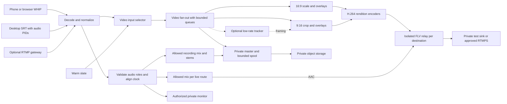

# Ziipa live media pipeline

Design for Live Feeds, Creator Studio and private recordings. The first release keeps the current direct broadcast path available. It adds an opt-in rehearsal lane for one source, a horizontal program, a vertical program and a recorded mix assembled from separately supplied audio tracks. Public routing follows after the rehearsal and destination tests pass.

## Start with the current live path

Ziipa's `backend/live_api.py` provisions Livepeer Studio streams, delivers WHIP or external RTMP credentials after the creator enables public ingest, checks provider state and supports a Twitch relay. The web and native `live-transmitter` components send the camera and microphone. The signed `asset.ready` path in `backend/live_webhooks.py` binds the asset to its actual provider session and parent stream. The opt-in import worker creates private media and up to three deterministic excerpt drafts, subject to the existing 100 MiB and 30-minute limits. Keep those entry points and the Live & recordings catalogue while adding the new media lane.

Livepeer Studio is winding down. The existing adapter can serve the current account while available. Keep the new control and media contracts provider neutral. FrameWorks is a migration candidate and needs its own capability discovery, routing, signed events, ownership checks and playback verification. Follow `LIVE-TRANSITION.md` for migration and acceptance. [Livepeer Studio transition](https://livepeer.org/blog/frameworks-livepeer-studio-transition), [FrameWorks migration guide](https://logbook.frameworks.network/migrate/livepeer-studio/).

| Lane | Ingest | Use |
| --- | --- | --- |
| Existing direct | Phone/web WHIP or external RTMP into the current provider | Supported provider playback and relay, with current program audio and private provider recording when enabled |
| Ziipa processed rehearsal | Managed WHIP receiver for phone/web, or desktop multi-track MPEG-TS over SRT | Private preview, fixed framing, explicit mixes and isolated test sinks |
| Ziipa processed live | Same processed receiver, with per-route capability checks and creator arming | 16:9 Ziipa playback and eligible external outputs, 9:16 only for destinations that accept it |

The processed lane requires a Ziipa receiver and client endpoint validation changes. Current clients validate Livepeer-specific URLs. Reuse their existing camera and permission flow with a typed, authenticated Ziipa ingest offer in a later app update. WHIP supports one track of each media kind. Take one video and one audio track from phone/web. Use an encoder or helper explicitly tested to send multiple discrete audio PIDs over SRT for live stem routing. For standard OBS recordings, separate local audio tracks also work as a post-production import. Confirm actual stream mapping in rehearsal before enabling the SRT lane. [WHIP single MediaStream restriction](https://www.rfc-editor.org/rfc/rfc9725.html#section-4.4.2), [GStreamer WHIP receiver](https://gstreamer.freedesktop.org/documentation/rswebrtc/whipserversrc.html), [GStreamer SRT input](https://gstreamer.freedesktop.org/documentation/srt/srtsrc.html), [OBS multi-track recording](https://obsproject.com/kb/multiple-audio-track-recording-guide).

## Media graph and worker isolation



Run an orchestrator on the existing API/worker stack. Run live media in a separate process/container per admitted broadcast generation on a measured media host. GStreamer owns long-lived clocks, switching, per-output queues and encoding. Use FFmpeg/ffprobe in separately scheduled, resource-capped workers to inspect inputs, validate recording fragments, remux stable outputs, render clips and reproduce crop/mix tests. Keep a single decode per input inside the live graph and reuse identical encoded renditions. Give each destination its own reconnectable relay process and private IPC queue. Share renditions across destinations only when video profile and audio policy match. No transcode or stream state mutation inside HTTP request handlers. [GStreamer branching](https://gstreamer.freedesktop.org/documentation/coreelements/tee.html), [GStreamer queues](https://gstreamer.freedesktop.org/documentation/coreelements/queue.html), [GStreamer FLV mux](https://gstreamer.freedesktop.org/documentation/flv/flvmux.html), [GStreamer RTMP sink](https://gstreamer.freedesktop.org/documentation/rtmp2/rtmp2sink.html), [FFmpeg stream selection](https://ffmpeg.org/ffmpeg.html#Stream-selection).

Use bounded, individually sized queues at every fan-out. A stalled remote socket can time out or disconnect only its own branch. Drop stale raw video on optional paths. If an encoded queue overruns, reset that relay and rejoin on the next keyframe with codec headers and synced audio. Track the resulting gap. Bound the recorder spool by bytes and duration. A spool overflow marks the recording incomplete and stops that branch while playback continues. Keep live, storage-upload, analytics and post-production workers on separate concurrency budgets. Each worker receives a sealed, typed route plan. Sink URLs come from approved adapters, credentials arrive as short-lived references where supported, and worker logs record route IDs. Validate inputs at the edge, restrict network egress, cap decoder/thread resources and pass fixed argument arrays to FFmpeg.

## Reframing and destination profiles

Start the rehearsal at 1280×720, 30 fps, SDR, with clean horizontal and vertical outputs of 1280×720 and 720×1280 when compute and destination profiles permit. Use H.264, 4:2:0, AAC at 48 kHz and a two-second closed GOP as lab defaults. Negotiate each live destination's profile, orientation, bitrate and keyframe rules through its adapter. A viewer-facing route remains selectable only after the capability check and destination proof. Captions and overlays are rendered at output size using safe zones stored in the profile revision.

1. Normalize input rotation and sample aspect ratio before matching a source-coordinate crop. Horizontal defaults to fit. Portrait supports **Fit**, **Center crop** and **Pinned frame** for the first release. Fit preserves wide screen shares and multi-person scenes with a letterbox layout. Center crop and pinned frame use chroma-aligned source pixels. For 1280×720, a centered 396×704 source window at `(442, 8)` is an exact 9:16 crop with even x/y offsets. Preview both layouts before arming.
2. Keep output caps stable for the session. A fixed-size crop can pan within the source. Use a compositor or fixed-size viewport stage for changes that alter geometry, and apply scene updates on a frame boundary. Preserve a crop/cue timeline tagged with frame running-time and approved layout revision so the clip renderer can reproduce the layout. [GStreamer crop](https://gstreamer.freedesktop.org/documentation/videocrop/videocrop.html), [GStreamer compositor](https://gstreamer.freedesktop.org/documentation/compositor/index.html).
3. Add opt-in subject framing only after manual layouts work. An asynchronous branch analyzes downscaled frames at a bounded rate, for example 5 fps, and returns bounding boxes, confidence and frame running-time. Smooth pan with a dead band and speed limit. Keep a short hold on subject loss, then return to pinned/fit framing. Reject stale or wrong-generation detections. Manual pin takes priority. Subject boxes are ephemeral layout data. Do not use face identity or connect detections to the CRM.

FFmpeg baseline filtergraph for a local two-stem rehearsal file. Label track roles from the manifest before compiling the graph. This example assumes a 1280×720 source with audio track 0 holding speech and track 1 holding music. The explicit maps are the routing control. `asplit` copies a signal, while per-track mapping distinguishes independently captured stems. [FFmpeg filtergraph and audio mixing](https://ffmpeg.org/ffmpeg-filters.html).

```text
[0:v:0]split=2[wide][vertical];
[wide]scale=1280:720,setsar=1[landscape];
[vertical]crop=396:704:442:8,scale=720:1280,setsar=1[portrait];
[0:a:0]aresample=48000,asplit=2[speech_live][speech_record];
[0:a:1]aresample=48000,volume=0.25[music_live];
[speech_live][music_live]amix=inputs=2:normalize=1[live_mix]
```

For this fixture, route `[landscape]` + `[live_mix]` to the approved full-mix sink and `[portrait]` + `[speech_record]` to the simulated speech-only sink using explicit `-map` options. The example illustrates distinct mixes and aspect outputs. In production each destination receives its own policy-selected audio bus, independent of aspect ratio. Audio for a recording also has its own policy.

The local FFmpeg check produced 1280×720 and 720×1280 at 30 fps with square pixels. With synthetic 440 Hz speech and 880 Hz music inputs, both tones were measured in the live mix and only 440 Hz was measured in the recording branch. The exercise used in-memory media and null sinks. The live GStreamer graph, socket failover and physical device path still need acceptance tests.

## Audio stems and route policy

Assign each declared input a stable role such as `speech`, `system`, `music`, `guest` or `program_mix`. Bind it to the verified track ID/PID and input-session generation. Use isolated inputs from the creator as the canonical stems. Normalize/resample to 48 kHz, time-align, apply per-stem gain, reserve headroom and use a limiter at each bus. A music exclusion controls both relay and recording mixes before encoding. Preview and audition what each route actually hears. [GStreamer audio mixer](https://gstreamer.freedesktop.org/documentation/audiomixer/audiomixer.html).

| Condition | Result |
| --- | --- |
| Creator enables a specific destination and confirms permissions for its declared stems | Mix only those stems on that output |
| Creator consents to private recording and permits selected stems there | Record only the allowed mix and optionally the specifically authorized discrete stems |
| Only mixed audio is present | Route it as `program_mix` only where the creator explicitly permits that entire mix |
| A required stem is missing, stale or unmapped | Produce timestamped silence for that role or hold the affected route according to its policy |
| A route excludes music but receives only a mixed signal | Require a discrete approved stem or keep that route audio muted/held |
| Permission is revoked or destination ownership changes | Stop the affected egress and discard queued unauthorized buffers. Stop public playback if its authorization is revoked |

Any monitor bus is private and subject to source permissions as well. There is no default raw master bypass. An approved speech track can still contain ambient or mic bleed. Label the output by what was routed, for example **Speech track only**. Audio engineering cannot establish rights or promise a claim-free recording. Keep licensing decisions with the creator and destination policy.

For mixed-audio separation, start with a private post-production experiment using rights-cleared inputs. A live model is a later option for an explicitly selected delayed route. Benchmark real-time factor, latency including chunk lookahead, voice intelligibility, music leakage and artifacts on speech, singing and scene changes. Use a separate worker and fixed delay budget with matching video delay before the mux. Treat it as an estimate, require reviewer approval for republishing, and route silence or an approved discrete stem on deadline miss. Do not fall back to an unapproved program mix. Live ASR, polls and scene cues are optional observers after the core graph works. An authorized cue selects only a preset from the manifest and cannot activate a destination. Transcripts and raw mixer samples stay outside the outbox.

## Clocks, health and failover

- Map both audio and video to a monotonic per-generation `running_time_ns` derived from the pipeline clock and segment metadata. Preserve capture RTP/PTS/DTS and rational time base on ingest for diagnostics. Record a mapping to UTC for operators and recording manifests. Use bounded audio resampling and video repeat/drop for measured drift. Never retimestamp on wall-clock jumps. Tag reconnect discontinuities explicitly. [GStreamer clocks](https://gstreamer.freedesktop.org/documentation/application-development/advanced/clocks.html).
- Initial lab targets are 5 seconds of decodable stable video/caps and audio lock or approved silence before `ingest.stable`, 3 seconds of no usable source media before a loss incident, p95 receiver-to-relay output under 750 ms and absolute A/V skew under 80 ms on healthy links. Measure first-frame time and glass-to-glass latency independently, since the provider and player add buffering. Tune thresholds per input protocol and network quality. Admission requires spare CPU, encoder slots, outbound headroom and spool disk at representative load.
- Once an explicitly armed, verified stream is live, hot-switch to the approved local slate plus timestamped silence on source loss. Use aligned caps and `input-selector` with stream synchronization, clock mode and backward buffer dropping. Keep egress encoders and mux alive, request an IDR on each switch, ramp permitted audio, and verify playback stays current. A provider can still terminate or time out, in which case clear its live proof and show **Reconnecting**. Recover only on stable ingest, current authorization and renewed playback proof. Cap hold time, initially 60 seconds and extendable to a deliberately approved limit. [GStreamer selector and clock synchronization](https://gstreamer.freedesktop.org/documentation/coreelements/input-selector.html).
- A local lane outage closes its leases. Provider failover is separate, requires prior authorization for target/metadata and can produce a new stream or broken URL. Version provider session mappings and avoid two writers. Manual stop, expired arming, or revoked consent closes relays and credentials and cancels queued reopen work. The previous generation cannot resume, even if its worker or webhook returns late.

## Control-plane events and recording lineage

The immutable manifest revision selects source, tracks and gains, aspect profiles, exact allowed destinations, media rights/recording consent, slate and hold timeout. Preflight checks resources, endpoint health and the active grant without publishing. Explicit creator arming starts an `awaiting_media` generation and issues temporary media leases. The supervisor sends the control plane authenticated, deduplicated lifecycle facts with `broadcast_id`, `manifest_revision`, `generation`, `operation_id` and `destination_id` where applicable. The control plane validates the expected generation and state before accepting a fact and records accepted transitions with its outbox transaction. Frames, per-second bitrate and inference results run on the media/telemetry plane.

| Fact | Control behavior |
| --- | --- |
| `com.ziipa.broadcast.ingest.stable.v1` | Source is ready on the current generation, stay `awaiting_media` until required outputs have proof |
| `com.ziipa.broadcast.destination.playback_verified.v1` | Publish route health based on current provider receipt or matching fresh playback proof, including independent Ziipa playback for the Live Feed card. A socket handshake alone stays connecting |
| `com.ziipa.broadcast.ingest.lost.v1` | Enter `failover_hold` if armed and slate is permitted. Keep per-route status visible and expire stale proofs |
| `com.ziipa.broadcast.master.committed.v1` | Trigger private post-production for a finalized, verified master. Missing/incomplete recordings have explicit receipts and do not block closing the stream forever |

For the new recorder, feed one permitted master video and the approved mix/stems into keyframe-aligned, independently playable fragments using `splitmuxsink` with async finalize and a bounded local spool. A branch gap becomes explicit timeline metadata. On stop, finalize, probe and hash closed fragments. Upload under private, generation-scoped keys and verify sizes and digests. Commit a manifest with `broadcast_id`, `manifest_revision`, `generation`, input/provider session IDs, fragment sequence and time ranges, codec/time base, track roles, rights/consent revision, SHA-256 and gap/slate intervals. Use unique sequence keys for idempotent retries. Require a durable verified object manifest before emitting `master.committed`; mark missing fragments as partial and route them to manual review. Existing provider recording callbacks continue through the existing verified importer. [GStreamer splitmuxsink keyframe and finalization behavior](https://gstreamer.freedesktop.org/documentation/multifile/splitmuxsink.html), [FFmpeg segment/concat formats](https://ffmpeg.org/ffmpeg-formats.html).

The private Clips grid reads approved lineage from this master. FFmpeg extracts candidate intervals using confirmed timeline ranges, honors gap/slate flags, applies the saved crop/overlay recipe and produces editable drafts. Audio peaks, authorized chat counts and consented captions can rank clips later. Do not keep every source or stem by default. Publish only through the creator's existing explicit review and permissions. Live Feed uses fresh playback verification for Live now, scheduled manifest data for Events and owner-scoped recording rows for Recordings and Clips.

## Release gates and free-tier budget

1. **Rehearsal.** Run a synthetic offline test with a visible time counter, left/right pan target and two different audio tones. Validate output aspect and chroma coordinates, independently prove the record mix excludes the disallowed tone, test repeated slate cuts and verify nondecreasing per-track timestamps and A/V skew. Disconnect a relay, fill the recorder spool, restart a worker, revoke consent and replay a late event. Confirm no unexpected public egress or duplicate artifacts. Capture actual CPU, memory, disk, outbound bandwidth and p95 latency on the intended host.
2. **Provider acceptance.** Verify the current account and migration status, use a dedicated short approved test stream, confirm real provider playback, stop, signed recording event and private clip editing. Verify native and web clients and only then expose processed beta routes. The existing importer caps recordings by both size and duration. At an aggregate 3 Mbit/s, three minutes transfers about 67.5 MB before overhead. Enforce the hard byte cap independently and avoid assuming a 30-minute session will fit. Check provider/account meters for delivery, transcoding and storage.
3. **Expansion.** Enable one planned route at a time, then allow a validated second aspect and separate audio stems. Make the direct provider path available as a simpler creator choice when the processed lane is unavailable. A free tier is suitable for short, quota-controlled rehearsals when verified. FrameWorks currently lists caps of 3 streams, 200 viewers and 10 GB storage with 10,000 delivered minutes monthly and 30-day retention. Relayed destinations use viewer slots and delivered minutes. Enforce Ziipa budget limits below actual remaining provider caps, admit one remote rehearsal at a time and close cleanly before quota exhaustion. Local/self-hosted processing still consumes compute, bandwidth and disk. No persistent processing belongs on the free API container. Keep 4K/60, continuous linear channels and ML-enabled live separation outside the free beta until measured capacity and a funding decision support them. [FrameWorks Free plan and capacity limits](https://frameworks.network/pricing).
